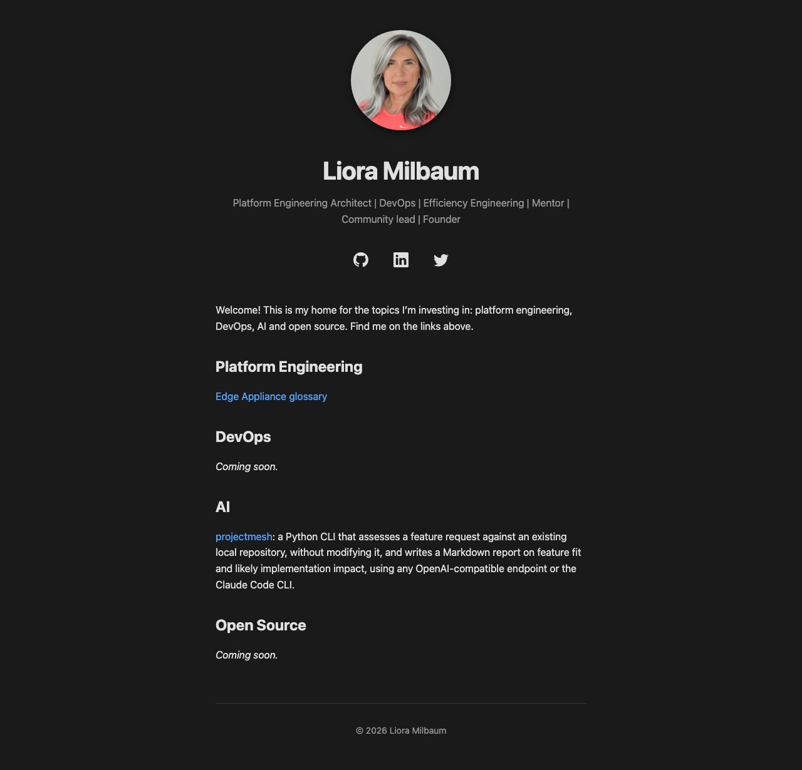

# Site snapshots after every deploy and on every PR

**PR:** [lioramilbaum/lioramilbaum.github.io#21](https://github.com/lioramilbaum/lioramilbaum.github.io/pull/21) · **Opened:** 2026-11-05 · **Hackathon:** [Day 1: Your factory's first delivery](https://github.com/orgs/qodo-hackathon/discussions/2)

## Why

In my Day 1 intro I promised automated site snapshots. Agents write and maintain this site while I steer it. A green build only proves the site compiled, not what a reader sees. I want each PR to show what the site looks like, and each deploy to leave a snapshot.

## How

- `scripts/snapshot-site.sh` runs a digest-pinned Playwright image and takes full-page, light-scheme screenshots of the homepage at 1280 and 390 px. The 1280 px width matches the November 4 baseline.
- Before each capture it runs `curl -f`, so an error page fails the run. It then checks each PNG's signature and width.
- It runs locally, on every PR, and after every deploy.
- After a deploy, a final `snapshot` job in `deploy-pages.yml` reads this commit's github-pages deployment time. It polls the homepage with a unique query and `Cache-Control: no-cache` until `Last-Modified` reaches that time. Only then does it capture, so a stale CDN copy cannot be labelled with the new commit.
- The job is read-only (`contents: read`, `deployments: read`), runs only upstream (the fork also deploys Pages), times out after 15 minutes, and is `continue-on-error`. It runs in the `pages` concurrency group on purpose, so a normal capture matches its commit; re-runs are covered by the newest-deployment checks.
- On PRs, the check-site smoke test captures the built `_site`.

Decisions, and what I rejected:

1. A `screenshots` branch from a separate workflow was built first. It needed a job with write access, a push-retry loop, and an append-only guard script.
2. Committing images to `main` was rejected. Every clone, CI checkout and Pages build would download all the images forever. Files on main get published unless excluded. Bot pushes would also bypass my one-commit PR flow.
3. Workflow artifacts won: no git storage and no write permission. The cost is that they expire (90 days for deploys, 14 for PRs), need a GitHub sign-in, and cannot be embedded. The `screenshots` branch stays frozen as the November 4 baseline, because its raw URL is in my Day 1 intro.
4. Homepage only: I decided only the homepage needs snapshots.
5. Every deploy, not only when the homepage changes: with the 90-day expiry, a quiet stretch would otherwise leave no current snapshot.

## What

| File | Change |
| --- | --- |
| `.github/workflows/deploy-pages.yml` | New `snapshot` job. Uploads `site-snapshots-<sha7>` (90 days). |
| `.github/workflows/check-site.yml` | Smoke test in `build`. Uploads `site-preview-<sha7>` (14 days). |
| `scripts/snapshot-site.sh` | New. Playwright screenshots, `curl -f` gate, PNG signature and width checks. |
| `renovate.json` | Regex manager that tracks the Playwright image pin. |
| `AGENTS.md` | Rule 7, plus Setup and Verify commands. |
| `.gitignore` | `_snapshots/` ignored. |
| `deliveries/2026-11-05-site-snapshots.md` | This doc. |

Download a deploy's snapshots with `gh run download <run-id> -R lioramilbaum/lioramilbaum.github.io -n site-snapshots-<sha7> -D _snapshots`.

## Evidence

**Run locally (macOS, Docker, 2026-11-05):**

- `shellcheck scripts/*.sh` and `actionlint -ignore 'label "ubuntu-26.04" is unknown' .github/workflows/*.yml`: clean.
- Live capture: `scripts/snapshot-site.sh https://lioramilbaum.com _snapshots` exited 0 and wrote `desktop.png` at 1280 px and `phone.png` at 390 px.
- Local `_site` capture: exited 0.
- Failure case: `https://lioramilbaum.com/does-not-exist` exited 22 at the `curl` pre-check, before any screenshot, and left no PNG.
- Re-run check, against the live deployments API: with `GITHUB_SHA` set to the newest deploy, b1fdd6d, the check passes, the poll finds the live homepage, and `skip=false`. With `GITHUB_SHA` set to the older deploy b1d0d64, it prints a notice, sets `skip=true` and exits 0. The confirm step gives the same result. Not covered: a newer deployment that failed or is still in progress also makes the job skip, which is conservative.

**Run in CI on this PR:**

- Check site [run 42060447666](https://github.com/lioramilbaum/lioramilbaum.github.io/actions/runs/42060447666) on 73e5fa3 passed: the build, the smoke test against the built `_site`, and delivery-doc (the regression tests and the delivery check).
- It uploaded the `site-preview-73e5fa3` artifact (203,381 bytes, expires 2026-11-19).
- The only later change is to this doc.

**Agent review (not a run):** my agent reviewer found two MEDIUM issues, both fixed: a stale CDN copy could be captured under the new commit, and 404 pages passed validation. It also found LOW issues, all fixed: no job timeout, an unclear error when no deployment was found, and a duplicate artifact name on re-runs.

**Not verified before merge:**

- The deploy-time `snapshot` job against the real CDN. TODO(evidence): after merge, link the first deploy run and its site-snapshots-<sha7> artifact.
- Whether Renovate picks up the image pin. The config validator passes.
- The re-run window described in Limitations.

## Screenshot or demo

TODO(evidence): desktop and phone PNGs from this PR's site-preview artifact, uploaded via a GitHub comment editor.

The November 4 baseline:



## What I learned from the Qodo review

Qodo reviewed commit 12e7774 about two and a half minutes after the PR left draft (ready_for_review 15:48:02 UTC; summary 15:48:44; review comment 15:50:27) and posted one MEDIUM finding, "Reruns can label newer pages as old" ([comment](https://github.com/lioramilbaum/lioramilbaum.github.io/pull/21#issuecomment-6662463689)). Qodo then reviewed 73e5fa3 and raised a second finding from its custom rule "Every PR includes a delivery doc": "Delivery doc reports live-capture results the PR says are unverified" (Compliance, remediation recommended).

- **Useful:** a real gap. Re-running an old deploy's snapshot job after a newer deploy would have captured the newer homepage under the old commit's name. My reviewer agent's passes didn't catch it; they focused on CDN staleness for the current deploy. The second finding is a fair clarity point: the evidence did not say where each check ran. The rule that raised it was created today, which shows Qodo now enforces it.
- **Questioned:** I took a different fix than Qodo suggested. Qodo proposed embedding a commit marker in the deployed HTML; that would touch both layouts and depend on Jekyll exposing the build SHA. I check instead that this commit is still the newest github-pages deployment, both before polling and right before capture, and skip with a notice if not. For ordinary pushes the `pages` concurrency group keeps a newer deploy from starting during the capture. A re-run may not queue in that group, so the second check narrows the race rather than closing it. I dismissed the first finding in Qodo as rejected, with the reason recorded, because I fixed it differently; the residual window is in Limitations. Qodo doubted runs that had actually happened: the live capture, the 404 failure case and the local `_site` capture all ran locally on macOS with Docker. The confusion came from mixing local runs, CI and post-merge checks in one list; the Evidence section now separates them.
- **Missed:** nothing I know of yet.
- **Changed in the factory:** a lesson for my reviewer prompts: ask "what happens on a re-run?" for any workflow that labels output with a commit.

## Assistance and third-party material

Built with Claude Code agents running Anthropic Claude models: a planner, an executor and a reviewer. I chose the design and approved each change. Screenshots use Playwright (Apache-2.0) from Microsoft's `mcr.microsoft.com/playwright` image; workflows use GitHub's official actions.

## Limitations

- Artifacts expire and cannot be embedded, so images in posts are uploaded by hand.
- Homepage only, light scheme only, two widths.
- A failed snapshot leaves the deploy green. It shows only as a failed job.
- PR previews are of the local build, so absolute URLs such as og:image still point at production.
- A re-run of an old snapshot job has a short window (about the capture time) in which a newer deploy could still land; the job re-checks right before capture to keep it small.

## Discussion post

Append this to my intro comment https://github.com/qodo-hackathon/software-factory-hackathon/discussions/2#discussioncomment-19397091 rather than posting a new one.

### Day 1: Your factory's first delivery (https://github.com/orgs/qodo-hackathon/discussions/2)

```markdown
## Challenge

Day 1, November 2, 2026: Your factory's first delivery

## Project

Project name: lioramilbaum.com
Repository link: https://github.com/lioramilbaum/lioramilbaum.github.io
Relevant pull request or commit: https://github.com/lioramilbaum/lioramilbaum.github.io/pull/21 ([delivery notes](https://github.com/lioramilbaum/lioramilbaum.github.io/blob/main/deliveries/2026-11-05-site-snapshots.md))

## What I completed

A green build only proves the site compiled, so each deploy and PR now leaves a screenshot of what a reader sees. Change of plan since my intro: the snapshots are workflow artifacts, not a `screenshots` branch. The November 4 image stays where it is.
- A `snapshot` job after each Pages deploy uploads `site-snapshots-<sha7>` (90 days).
- The check-site smoke test uploads `site-preview-<sha7>` on each PR (14 days).
- The Playwright image is pinned by digest, and Renovate tracks it.

## Evidence

Repository or PR link: https://github.com/lioramilbaum/lioramilbaum.github.io/pull/21
Screenshot or short demo: see the Optional demo section.
One lesson or decision from the Qodo review: a re-run of an older deploy could label a newer page with its old commit, so the snapshot now skips unless its commit is still the newest deploy. Qodo's second finding: the evidence did not say where each check ran, so I now label each one.
- Run locally (macOS, Docker): the live capture exits 0 with 1280 px and 390 px PNGs; a 404 URL exits 22 at the curl pre-check with no PNG.
- Run in CI on this PR: [run 42060447666](https://github.com/lioramilbaum/lioramilbaum.github.io/actions/runs/42060447666) on 73e5fa3 passed (Check site and delivery-doc), and uploaded `site-preview-73e5fa3` (expires 2026-11-19).
- My reviewer's MEDIUM findings, both fixed: a stale CDN copy could be captured under the new commit, and 404 pages passed validation.
- Decision: artifacts over a branch, because a branch needed write access, a push-retry loop and a guard script.

## What I learned / what is blocked

Qodo: its first finding (a re-run could label a newer page with the old commit) I dismissed in Qodo as rejected, because I fixed it by skipping unless the commit is still the newest deploy, rather than embedding a commit marker; the second check narrows, but does not fully close, the window for a re-run. Its second finding (the evidence did not say where each check ran) is fair, and the rule that raised it is new today.
Limitations: artifacts expire and cannot be embedded; homepage only, light scheme only; a failed snapshot leaves the deploy green.

## Assistance and third-party material

Built with Claude Code agents running Anthropic Claude models: a planner, an executor and a reviewer. I chose the design and approved each change. Screenshots use Playwright (Apache-2.0) from Microsoft's `mcr.microsoft.com/playwright` image; workflows use GitHub's official actions.

## Optional demo

TODO(evidence): desktop and phone PNGs from this PR's site-preview artifact, uploaded via a GitHub comment editor.
```
