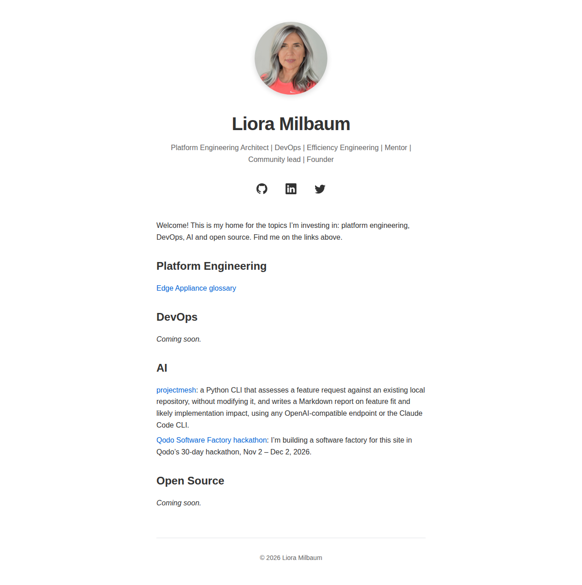

# feat: show my Qodo Software Factory hackathon participation, with a LinkedIn share button (#27)

**PR:** [#34](https://github.com/lioramilbaum/lioramilbaum.github.io/pull/34) · **Opened:** 2026-11-07

## Why

_From the PR description (author-written)._

I'm taking part in [Qodo](https://www.qodo.ai)'s [Build a Software Factory in 30 Days](https://hackathon.qodo.ai/) hackathon (Nov 2 – Dec 2, 2026), and lioramilbaum.com is my hackathon project. Nothing on the site said so. Visitors should be able to see that I'm participating, follow the work, and share it on LinkedIn in one click.

## How

_From the PR description (author-written)._

- New page `docs/qodo-software-factory-hackathon.md` (`docs` layout, permalink `/docs/qodo-software-factory-hackathon/`). It links Qodo, the hackathon site, the daily challenges, the discussions, my Day 1 and Day 2 submissions, and the factory's artifacts (AGENTS.md and `deliveries/`). It sets its own title, description and image, so the LinkedIn card describes the hackathon. The image reuses my profile photo.
- The share button is a plain link to LinkedIn's `share-offsite` URL, with an inline SVG icon and styles inline in the layout. It uses no LinkedIn widget, external script or external CSS. It opens in a new tab with `rel="noopener noreferrer"` and has an accessible label. It renders only on pages that set `share_on_linkedin: true`, so the glossary doesn't get it.
- The footer year was set by an inline `<script>`, and the page must have no `<script>` tag. The year now comes from the build (`site.time`) in both layouts, so the shared footer stays identical (AGENTS.md rule 4). A yearly scheduled redeploy on January 1 rolls it over.
- CI tests every line this PR adds (AGENTS.md rule 8):
  - `scripts/check-site.sh` checks, on the built site:
    - the homepage link;
    - the page's links;
    - its og tags;
    - the exact share href, its attributes and visible text;
    - that neither the button nor its styles appear on the glossary;
    - no script, external stylesheet or CDN font on the page;
    - the footer shows the build year on every page. The expected year comes from the build (the homepage's write time), not the clock when the check runs;
    - on every page, og:image is either absent or an absolute `https://lioramilbaum.com/` URL to a file in the build.
  - `scripts/check-browser.sh` opens the built page in the digest-pinned Playwright image, with JavaScript off. It checks:
    - the share link is present and visible, with the exact href and its text;
    - the page loads no script and makes no off-site request;
    - the computed style of every declaration in the share button's CSS, including keyboard focus and hover;
    - WCAG AA contrast (4.5:1) in light and dark mode.

    It serves the site inside the container, so it runs on CI's Linux runners. Playwright's npm packages are installed with `npm ci` from a committed lockfile with integrity hashes. The script fails if their version differs from the image's. Renovate moves the image and the lockfile in one PR. On a PR, CI runs it whenever the layouts, pages, the workflow or the check change; manual runs always run it.
  - `scripts/check-workflows.sh` parses every workflow file offline in the Jekyll build image. It asserts the deploy workflow's January 1 schedule, its push to `main`, and the `workflow_dispatch` fallback. It accepts YAML anchors and every `on:` form GitHub allows (an event, a list or a mapping); only `deploy-pages.yml` must use a mapping.
  - `scripts/check-links.sh` confirms that the page's external links resolve, with retries, timeouts and a fixed user agent. CI runs it on every PR as a non-blocking last step, so a dead link shows as a warning. The links are checked in parallel batches of 8, so the page's worst case (266 s) fits CI's 5-minute step timeout. The Day 1 and Day 2 comment ids are looked up through GitHub's REST API, without a token, so a wrong `#discussioncomment-…` id warns too. These are third-party sites, and a blocking check would stall Renovate's automerge and the delivery-doc generator on someone else's outage.
- Each new check went red once in CI against a deliberately broken revision (rule 8):
  - check-site.sh, wrong footer year: https://github.com/lioramilbaum/lioramilbaum.github.io/actions/runs/42417349232
  - check-workflows.sh, schedule removed: https://github.com/lioramilbaum/lioramilbaum.github.io/actions/runs/42417421194
  - check-browser.sh, dark-mode colour with 3.2:1 contrast: https://github.com/lioramilbaum/lioramilbaum.github.io/actions/runs/42417497908
  - check-links.sh, dead link (warning; the job stays green): https://github.com/lioramilbaum/lioramilbaum.github.io/actions/runs/42417608266
  - check-site.sh, footer year from the build: https://github.com/lioramilbaum/lioramilbaum.github.io/actions/runs/42449389128
  - check-links.sh, wrong comment id (404 warning; the job stays green): https://github.com/lioramilbaum/lioramilbaum.github.io/actions/runs/42449465118

## What

_From the PR description (author-written)._

- New:
  - `docs/qodo-software-factory-hackathon.md`
  - `scripts/check-links.sh`
  - `scripts/check-browser.sh` with `scripts/check-browser/package.json` and `package-lock.json`
  - `scripts/check-workflows.sh`
- `_layouts/docs.html`: the opt-in LinkedIn share button and its styles; the footer year without JavaScript.
- `_layouts/home.html`: the footer year without JavaScript.
- `.github/workflows/deploy-pages.yml`: a yearly `schedule` trigger so the footer year rolls over.
- `.github/workflows/check-site.yml`: three steps in the build job:
  - the workflow check, which blocks;
  - the browser check, which blocks and is path-gated;
  - the external link check, which only warns. It runs without a token: the comment lookups use the unauthenticated API.
- `renovate.json`: a Playwright group, so the image and its npm lockfile move together, and automerge for both.
- `README.md`: a link to the page under **AI**.
- `scripts/check-site.sh`: the assertions above.
- `AGENTS.md`:
  - the new commands in Setup and Verify;
  - rule 5: the browser check reads the Playwright image pin and uses the lockfile.

## Evidence

- Ran in CI: [run 42454393844](https://github.com/lioramilbaum/lioramilbaum.github.io/actions/runs/42454393844) on 1786fb6 (content 15bdfc93f657a233171a0320c7c54107374090cf). Jobs: build: success.
- Homepage: changed. The head build (H 5840ed9dc06ed8bfc09b7fd6698c7f0457f045b6) differs from the merge-base 2c8edf3 build. Screenshot below.
- Local: built the head and the merge-base (2c8edf3) with scripts/build-site.sh, and compared their homepages.

## Screenshot or demo

## What I learned from the Qodo review

Qodo reviewed these contents (by content digest): `df3a4861c18d870e3a740747d8d9fd90ab9ebda3`, `db5270c38138a19c768e20e889befe1c2e9e3885`, `a97fd2a884e2f698e7d6454a7e36011cb843187b`, `399bffaf06bbc759d6eb89a55634c4403a166d99`, `aa54b8734e179aaa4085f1d097f64a987e3f34c7`, `15bdfc93f657a233171a0320c7c54107374090cf`. Its latest review is content `15bdfc93f657a233171a0320c7c54107374090cf`.

- PR ships without its delivery document (📘 Rule violation). No longer listed by Qodo. Reviewed in content `df3a4861c18d870e3a740747d8d9fd90ab9ebda3`, `db5270c38138a19c768e20e889befe1c2e9e3885`, `a97fd2a884e2f698e7d6454a7e36011cb843187b`, `399bffaf06bbc759d6eb89a55634c4403a166d99`, `aa54b8734e179aaa4085f1d097f64a987e3f34c7`.
- Year-end builds fail valid site checks (Medium, 🐞 Bug). No longer listed by Qodo. Reviewed in content `df3a4861c18d870e3a740747d8d9fd90ab9ebda3`.
- Slow links leave later links unchecked (Medium, 🐞 Bug). No longer listed by Qodo. Reviewed in content `df3a4861c18d870e3a740747d8d9fd90ab9ebda3`, `db5270c38138a19c768e20e889befe1c2e9e3885`, `a97fd2a884e2f698e7d6454a7e36011cb843187b`, `399bffaf06bbc759d6eb89a55634c4403a166d99`, `aa54b8734e179aaa4085f1d097f64a987e3f34c7`.
- Manual reruns can silently skip the browser check (Low, 🐞 Bug). No longer listed by Qodo. Reviewed in content `df3a4861c18d870e3a740747d8d9fd90ab9ebda3`, `db5270c38138a19c768e20e889befe1c2e9e3885`, `a97fd2a884e2f698e7d6454a7e36011cb843187b`.
- Broken submission links pass link checks (Medium, 🐞 Bug). No longer listed by Qodo. Reviewed in content `df3a4861c18d870e3a740747d8d9fd90ab9ebda3`.
- Day 2 link may point to the wrong comment (Medium, 🐞 Bug). No longer listed by Qodo. Reviewed in content `399bffaf06bbc759d6eb89a55634c4403a166d99`, `aa54b8734e179aaa4085f1d097f64a987e3f34c7`.
- Pull requests can expose the read token (Medium, 🐞 Bug). No longer listed by Qodo. Reviewed in content `aa54b8734e179aaa4085f1d097f64a987e3f34c7`, `15bdfc93f657a233171a0320c7c54107374090cf`.
- Valid workflow files can fail the workflow check (Low, 🐞 Bug). No longer listed by Qodo. Reviewed in content `aa54b8734e179aaa4085f1d097f64a987e3f34c7`.
- Local site checks fail on macOS (Medium, 🐞 Bug). Open in Qodo's latest review. Reviewed in content `aa54b8734e179aaa4085f1d097f64a987e3f34c7`, `15bdfc93f657a233171a0320c7c54107374090cf`.
- Delivery doc says the link check gets a token it doesn&#x27;t (Low, 🐞 Bug). Open in Qodo's latest review. Reviewed in content `15bdfc93f657a233171a0320c7c54107374090cf`.
- Submission link check may always report 404 (Medium, 🐞 Bug). Open in Qodo's latest review. Reviewed in content `15bdfc93f657a233171a0320c7c54107374090cf`.

The PR description has no `## Qodo notes` section.

## Assistance and third-party material

_From the PR description (author-written)._

Built with Claude Code agents running Anthropic Claude models: planners, executors and reviewers. I chose the design and approved each change. The LinkedIn icon is the same SVG path the homepage already uses. The share link uses LinkedIn's public `share-offsite` URL, and no LinkedIn code is loaded. No Qodo artwork is used. The browser check uses Microsoft's Playwright (Apache-2.0), from its digest-pinned image and npm packages.

## Limitations

_From the PR description (author-written)._

- The page says "participating". I'll update the wording by hand after the hackathon ends on December 2.
- Only Day 1 and Day 2 are linked. Later submissions are reached through the discussions link.
- The checks themselves (`check-site.sh`, `check-browser.sh`, `check-workflows.sh`, `check-links.sh`) run in CI but have no tests of their own, as rule 8 allows. Each went red once in CI (links above).
- CI checks that the links resolve, but only warns, so a third-party outage doesn't block a PR. A link that breaks after merge isn't noticed until the next PR runs.
- In CI, the comment lookups don't use a token, because the script comes from the PR. They share the unauthenticated API limit (60 requests an hour per runner IP), so a rate-limited runner shows a 403 warning. The step only warns.
- Some things CI can't test:
  - LinkedIn's share dialog and preview card. The dialog needs a signed-in LinkedIn account, and the card can only be fetched once the page is live, and LinkedIn caches it. After merge, I'll check both with LinkedIn's Post Inspector.
  - The schedule can't fire in CI: GitHub runs it only on `main` at the cron time. CI asserts that it exists and parses. It is best-effort, because GitHub disables schedules after 60 days without repo activity; `workflow_dispatch` is the manual fallback.
- The workflow files are parsed as YAML, not validated against GitHub's workflow schema (no actionlint yet).
- The browser check runs in Chromium only. On a PR, it runs only when the layouts, pages, the workflow or the check change. Manual runs always run it.
- The preview image is my square profile photo, so LinkedIn may show a small thumbnail instead of a wide card.

## Discussion post

This PR has no `## Hackathon` section, so there is no discussion post.
<!-- delivery: content=15bdfc93f657a233171a0320c7c54107374090cf homepage=5840ed9dc06ed8bfc09b7fd6698c7f0457f045b6 -->
