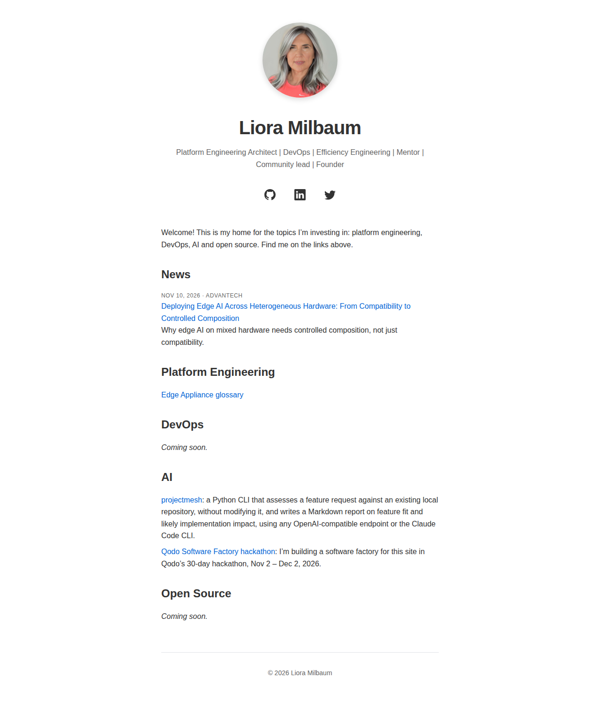

# feat: Homepage: add a News section, starting with the Advantech article

**PR:** [#79](https://github.com/lioramilbaum/lioramilbaum.github.io/pull/79) · **Opened:** 2026-11-13

## Why

_From the PR description (author-written)._

The homepage had nowhere to announce publications, talks or releases: its only sections are the four topic sections that AGENTS.md rule 3 fixes. #74 needs a place to announce the Advantech article, and later announcements will need one too. This PR adds a `## News` section as the first section of the homepage, with the Advantech article as its first entry.

## How

_From the PR description (author-written)._

- **Markup.** News is a plain kramdown list tagged `{: .news}`, so the homepage needs no HTML. Each entry is a loose list item with up to three paragraphs: the date and publisher line, the linked title, and an optional one-line summary. Because the entry is loose, kramdown wraps each part in its own `
`, so the title sits on its own line with no extra markup.
- **Style.** A small block in `_layouts/home.html`'s existing inline `<style>` targets `.news li > p:first-child` (the date line). The date line is small, uppercase and muted, in the tagline's colours: `#666` in light mode, `#999` in dark mode, which stays readable on `#1a1a1a`. Titles keep the existing `.content a` link colours. `.news li` adds space between entries. There is no JavaScript, no icon, no badge and no external CSS (rule 4). News appears only on the homepage, so `_layouts/docs.html` is unchanged.
- **Checks.** `scripts/check-site.sh` now checks the built homepage for:
  - a `News` `<h2>`, placed above the `Platform Engineering` `<h2>`;
  - the `news` class on the News list;
  - a `.news` rule with `color: #666` and a dark-mode `.news` rule with `color: #999` in the page's styles;
  - the Advantech article link and the `Nov 10, 2026 · Advantech` line in the News section;
  - between 1 and 5 `<li>` entries in the News list. Zero entries also fails, so an unreadable list can't pass (rule 11).

  CI already runs `check-site.sh` (`bash scripts/check-site.sh _site` in `check-site.yml`), so no workflow change was needed.
- **Rule.** AGENTS.md rule 3 now names News as the first homepage section and gives its entry format and its 5-entry cap.

## What

_From the PR description (author-written)._

- `README.md`: a new `## News` section above `## Platform Engineering`. Its one entry is *Deploying Edge AI Across Heterogeneous Hardware: From Compatibility to Controlled Composition*, published by Advantech on Nov 10, 2026, with a one-line summary. The site copy makes no claim about LinkedIn Newsletter publication.
- `_layouts/home.html`: the `.news` styles (date line, entry spacing, dark-mode colour).
- `scripts/check-site.sh`: the News assertions listed under How. The existing topic-section and link assertions are unchanged.
- `AGENTS.md`: rule 3 covers the News section.

## Evidence

- Ran in CI: [run 43514413570](https://github.com/lioramilbaum/lioramilbaum.github.io/actions/runs/43514413570) on 623eaf0 (content f584b1172ca06afef1e9fdbae60889248752663e). Jobs: build: success.
- Homepage: changed. The head build (H a37e654e96b010d71a0bd6701e0f4da16755bc8d) differs from the merge-base 4f94ce2 build. Screenshot below.
- Local: built the head and the merge-base (4f94ce2) with scripts/build-site.sh, and compared their homepages.

## Screenshot or demo

## What I learned from the Qodo review

Qodo reviewed these contents (by content digest): `f584b1172ca06afef1e9fdbae60889248752663e`. Its latest review is content `f584b1172ca06afef1e9fdbae60889248752663e`.

Qodo's latest review lists no findings.

The PR description has no `## Qodo notes` section.

## Assistance and third-party material

_From the PR description (author-written)._

Written by Claude Code (claude-opus-5-5), run by the repo's agent runner on issue #78. The article title, URL, publisher and date come from the issue. No third-party code or assets.

## Limitations

_From the PR description (author-written)._

- The agent run cannot run commands, so this change was not built or checked locally. The runner's checks and CI are the first build. Two things are expected but unverified:
  - kramdown applies the `{: .news}` that follows the list's last line to the `<ul>`;
  - the `·` in the date line comes out as a literal character.

  If either is wrong, the new `check-site.sh` assertions fail, so CI goes red rather than passing.
- Rule 8 asks for each new check to be run once in CI against a failing input, with that red run linked here. The agent can't push a broken revision, so there is no such run yet. On a build of `main` (no News section), the first assertion (`missing section: ## News`) fails. The class, colour, link and date assertions would fail on `main` too, but `check-site.sh` stops at the first failure, so CI shows only that first one. The cap's failing path (a sixth entry) hasn't been run in CI. The owner can show it by pushing a revision with six entries.
- Owner follow-up, outside this PR: if the hand-added Qodo rule for rule 3 names the four sections, update it in Qodo's dashboard, because it doesn't re-sync from `AGENTS.md`. Close #74 when this merges.

## Discussion post

This PR has no `## Hackathon` section, so there is no discussion post.
<!-- delivery: content=f584b1172ca06afef1e9fdbae60889248752663e head=623eaf0d28430a2d49d38d85dc41dfe66fff2a5a homepage=a37e654e96b010d71a0bd6701e0f4da16755bc8d qodo-open=0 -->
