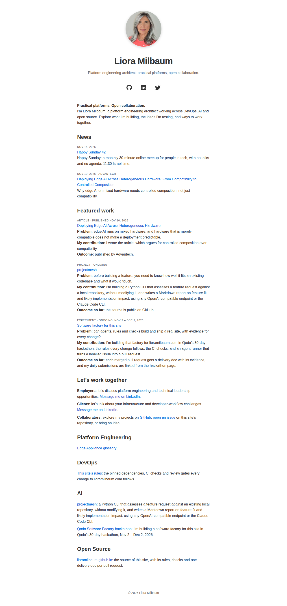

# feat: Homepage: announce the Happy Sunday meetup and the Nov 15 session

**PR:** [#91](https://github.com/lioramilbaum/lioramilbaum.github.io/pull/91) · **Opened:** 2026-11-14

## Why

_From the PR description (author-written)._

Happy Sunday is a monthly meetup Liora hosts for people in tech: 30 minutes online, no talks and no agenda, open to any tech role. The site did not mention it. The next session, Happy Sunday #2, is on Sunday, Nov 15, 2026, 11:30–12:00 Israel time, with free registration on Luma, so the homepage's News list should announce it before it starts.

## How

_From the PR description (author-written)._

The announcement is a new entry at the top of the homepage's `## News` list, in the format AGENTS.md rule 3 sets: the date line alone (there is no external publisher), the linked title, and a one-line summary. Rule 3 also requires an assertion in `scripts/check-site.sh` for every new homepage link. The new assertion finds the News entry by its Luma link and checks that it comes before the Advantech entry, so a newer entry can go above it later.

## What

_From the PR description (author-written)._

- `README.md`: a News entry above the Nov 10, 2026 Advantech entry. Its date line is `Nov 15, 2026`, its title [Happy Sunday #2](https://luma.com/x53cwkbd), and its summary reads "Happy Sunday: a monthly 30-minute online meetup for people in tech, with no talks and no agenda. 11:30 Israel time." The News list now has 2 entries, under the cap of 5.
- `scripts/check-site.sh`: finds the News entry that links to `https://luma.com/x53cwkbd` in `_site/index.html` and fails unless it has the date line `
Nov 15, 2026
`, a summary that names Happy Sunday as a monthly online meetup for people in tech, and a position above the Advantech entry. Each failure gets its own message. The existing Advantech, entry-count and section-order assertions are not changed.

## Evidence

- Ran in CI: [run 43589211621](https://github.com/lioramilbaum/lioramilbaum.github.io/actions/runs/43589211621) on 74d82cb (content f499b1c026fbeeba65dab54dd26faed090a93ca7). Jobs: build: success.
- Homepage: changed. The head build (H 1a35c1dc9a4616a86ffff9a6a46ca2d8482a49f6) differs from the merge-base 2a17050 build. Screenshot below.
- Local: built the head and the merge-base (2a17050) with scripts/build-site.sh, and compared their homepages.

## Screenshot or demo

## What I learned from the Qodo review

Qodo reviewed these contents (by content digest): `1cbb6ab84e65dedd826bae480d161d04136b3445`, `f499b1c026fbeeba65dab54dd26faed090a93ca7`. Its latest review is content `f499b1c026fbeeba65dab54dd26faed090a93ca7`.

- Homepage News check will break on the next entry added above it (Medium, 🐞 Bug). No longer listed by Qodo. Reviewed in content `1cbb6ab84e65dedd826bae480d161d04136b3445`.

Open findings in Qodo's latest review: 0.

The PR description has no `## Qodo notes` section.

## Assistance and third-party material

_From the PR description (author-written)._

Claude Code (claude-opus-5-5), run by the repo's agent runner (`scripts/agent-run.sh`) on issue #85, wrote this change. The owner reviews and merges it. No third-party material: the Luma URL and the session details come from the issue.

## Limitations

_From the PR description (author-written)._

- The new assertion fails on a build of `main` because `main`'s homepage has no Luma link, so its first News entry is the Advantech one. The agent could not run a build to show this. Per rule 8, a new check needs a CI run against failing input: a deliberately broken revision and the red run's link still have to be added here. The agent cannot push one.
- Whether the change is on lioramilbaum.com before 11:30 Israel time on Nov 15, 2026 depends on the owner merging it in time, which deploys `main`. The agent cannot merge or deploy, so this PR does not meet that criterion by itself.
- After Nov 15, the entry links to a past session. The issue leaves open whether it should become a standing link to the series. This PR does not change that.

## Discussion post

This PR has no `## Hackathon` section, so there is no discussion post.
<!-- delivery: content=f499b1c026fbeeba65dab54dd26faed090a93ca7 head=74d82cb91ef7285c192e4083ee8cf14f64caa131 homepage=1a35c1dc9a4616a86ffff9a6a46ca2d8482a49f6 qodo-open=0 -->
