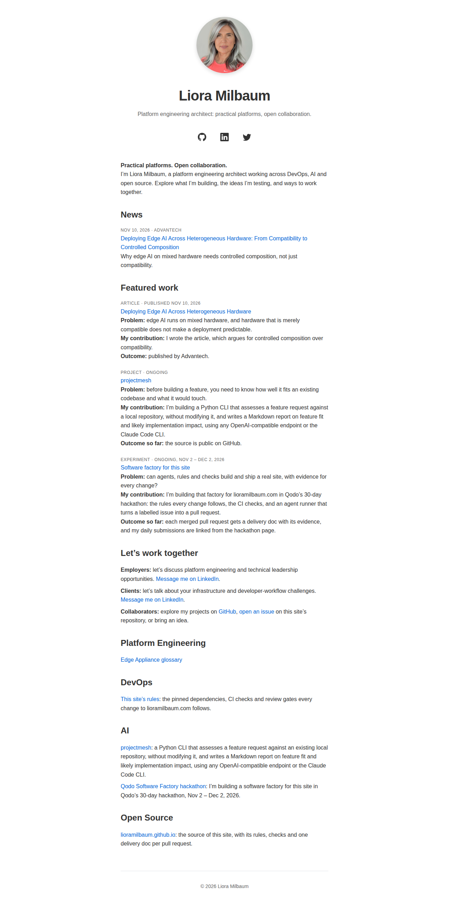

# feat: Clarify homepage identity and engagement paths for employers, clients, and collaborators

**PR:** [#88](https://github.com/lioramilbaum/lioramilbaum.github.io/pull/88) · **Opened:** 2026-11-14

## Why

_From the PR description (author-written)._

The homepage introduced Liora with six roles in one tagline ("Platform Engineering Architect | DevOps | Efficiency Engineering | Mentor | Community lead | Founder"). Two of its four topic sections said only "Coming soon", and it gave a visitor no next step. Issue #86 asks for one professional identity, the main work shown first with its context, and a clear next step for employers, clients and collaborators.

## How

_From the PR description (author-written)._

- **One identity.** The tagline (front matter `description`, also the og:description) is now "Platform engineering architect: practical platforms, open collaboration." The intro paragraph opens with the issue's positioning line, **Practical platforms. Open collaboration.**
- **Featured work.** A new `## Featured work` section sits after News (rule 3 keeps News as the first section) and before the topic sections. It has three items: the Advantech edge-AI article, projectmesh and the software-factory hackathon experiment. Each item gives the problem, Liora's contribution and the outcome. It reuses the existing `{: .news}` list style, so each item opens with a muted label line: `Article · Published Nov 10, 2026`, `Project · Ongoing`, `Experiment · Ongoing, Nov 2 – Dec 2, 2026`. This needed no layout or CSS change. The outcomes state only what the repo or the links show. The article is published by Advantech. projectmesh's source is public on GitHub. The hackathon pipeline gives each merged PR a delivery doc (rule 6), and the daily submissions are linked from the hackathon page. Work in progress is labelled ongoing and says "Outcome so far".
- **Next steps.** A new `## Let's work together` section links each audience to a destination the site already publishes. Employers and clients go to the LinkedIn profile from the layout's social links. Collaborators go to the GitHub profile and to this repo's issues. No new contact details were added.
- **No placeholders.** DevOps now links to this site's AGENTS.md (its pinned dependencies, CI checks and review gates). Open Source links to this site's repository. The four topic sections keep their names (rule 3).
- **CI.** `scripts/check-site.sh` now asserts each of these on the built homepage:
  - the tagline holds no `|` list;
  - the positioning line comes before News;
  - the viewport meta tag is present;
  - the sections run News, Featured work, Let's work together, Platform Engineering;
  - Featured work uses the news list and links to all three works;
  - each of the three label lines is present, as are three Problem, My contribution and Outcome lines;
  - each audience's next-step link is present;
  - the page has no "Coming soon" text;
  - every topic section has a link;
  - the new DevOps and Open Source links are present.

  Every new homepage link has an assertion (rule 3).
- **Rules.** AGENTS.md rule 3 now describes the new homepage contract.

## What

_From the PR description (author-written)._

- `README.md`: new tagline and positioning, plus the new `## Featured work` and `## Let's work together` sections. DevOps and Open Source now have content instead of "Coming soon".
- `scripts/check-site.sh`: the assertions above.
- `AGENTS.md`: rule 3 describes the positioning, Featured work, Let's work together and no-placeholder rules.

## Evidence

- Ran in CI: [run 43585185931](https://github.com/lioramilbaum/lioramilbaum.github.io/actions/runs/43585185931) on 0e18f51 (content 482c37651821bc2fb48422196c921c3fb0461f52). Jobs: build: success.
- Homepage: changed. The head build (H 099bf855d161b8ecfc0e925d9d4e0df6d8e0b912) differs from the merge-base e52250b build. Screenshot below.
- Local: built the head and the merge-base (e52250b) with scripts/build-site.sh, and compared their homepages.

## Screenshot or demo

## What I learned from the Qodo review

Qodo reviewed these contents (by content digest): `91598273384dd21b26d415c7bd6a6cf68aac85bb`, `482c37651821bc2fb48422196c921c3fb0461f52`. Its latest review is content `482c37651821bc2fb48422196c921c3fb0461f52`.

- Unverified article authorship is stated (Medium, 📎 Requirement gap). No longer listed by Qodo. Reviewed in content `91598273384dd21b26d415c7bd6a6cf68aac85bb`, `482c37651821bc2fb48422196c921c3fb0461f52`.
- Incomplete work items pass site checks (Medium, 🐞 Bug). No longer listed by Qodo. Reviewed in content `91598273384dd21b26d415c7bd6a6cf68aac85bb`.

Open findings in Qodo's latest review: 0.

The PR description has no `## Qodo notes` section.

## Assistance and third-party material

_From the PR description (author-written)._

Written by Claude Code (claude-opus-5-5), started on issue #86 by the agent runner (`scripts/agent-run.sh`). The positioning line and the three audience lines come from the copy suggested in issue #86. The projectmesh description reuses the homepage's existing text. No third-party code or assets were added.

## Limitations

_From the PR description (author-written)._

- The agent had no network access, so it opened none of the links. It did not confirm the Advantech article's byline (the "I wrote the article" line rests on the homepage's existing News entry and the issue) or projectmesh's current state (it is labelled "Ongoing"). The owner should confirm both. CI's link check (`scripts/check-links.sh`) covers the hackathon page only, and wiring the homepage into it needs a change to `.github/workflows/check-site.yml`, which the agent may not edit. Run `bash scripts/check-links.sh _site/index.html` by hand after a build. LinkedIn may answer a scripted request with a non-2xx code.
- The agent could not run the build or the checks. The runner runs them.
- Readability on mobile and desktop rests on the existing responsive layout: the viewport meta tag, the 40rem column and the existing list styles. No CSS changed. CI asserts the viewport tag and the structure, not the visual result. The delivery doc's homepage screenshot is 1280 px desktop only, so a mobile view is not captured in CI.
- `check-site.sh` is a check, so rule 8 asks for a red CI run on a failing input for its new assertions. The agent cannot push a broken revision, so no such run is linked here.

## Discussion post

This PR has no `## Hackathon` section, so there is no discussion post.
<!-- delivery: content=482c37651821bc2fb48422196c921c3fb0461f52 head=0e18f51add15d2daf1609841a1f6971497e5de6b homepage=099bf855d161b8ecfc0e925d9d4e0df6d8e0b912 qodo-open=0 -->
