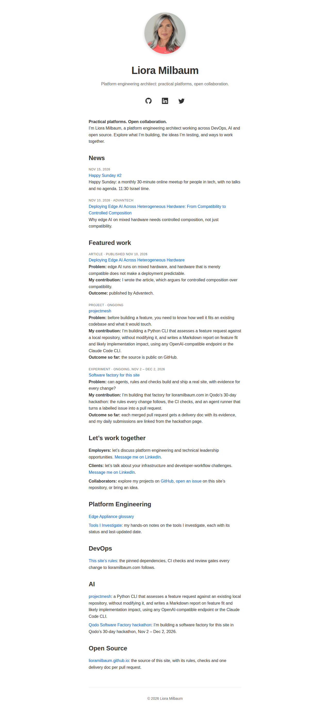

# feat: Add a Tools I Investigate section

**PR:** [#93](https://github.com/lioramilbaum/lioramilbaum.github.io/pull/93) · **Opened:** 2026-11-14

## Why

_From the PR description (author-written)._

Issue #87 asks for a Tools I Investigate section, so that employers, clients and collaborators can see the hands-on learning behind the site: what Liora is investigating, how far each investigation has got, and what she found. The issue also says the initial tool list and notes come from Liora, and that a tool picked for an integration is not yet an evaluated tool. So this PR adds the section and a repeatable entry format, and it publishes no entry.

## How

_From the PR description (author-written)._

- A new page, `docs/tools/index.md` (`/docs/tools/`), on the existing `docs` layout. It explains how to read an entry (*Exploring* means preliminary impressions; *Evaluated* means findings from a tested scenario) and says that investigating a tool is not an endorsement. Its list is built with Liquid from every page that sets `tool_status`, newest `last_updated` first, and each item shows the title, the status and the last-updated date. While no entry exists, the page says "No investigation is published here yet."
- An entry template, `docs/tools/_template.md`. Jekyll does not publish files whose names start with `_`, so the template stays in the repo only. To add an entry, copy it to `docs/tools/<tool>.md` and fill in the front matter (`title`, `summary`, `tool_url`, `tool_status`, `last_updated`) and the sections: the problem and why, the use case explored, findings (each marked as preliminary or tested), strengths, limitations and trade-offs, and examples and links. The template renders the official link, the status and the date as fixed lines, so every entry shows them the same way.
- The homepage links the page from **Platform Engineering**, with a relative `.md` link (rule 3). The four topic sections and their order are unchanged.
- `scripts/check-site.sh` adds assertions for the new link and page (rule 3 and rule 8):
  - the Platform Engineering section links `/docs/tools/`;
  - the page is built and has its heading, its no-endorsement line and the viewport meta tag, and no raw `.md` href;
  - the template is not published;
  - every built entry page has its Official site link, a Status line of *Exploring* or *Evaluated*, and a Last updated date, and the index links to it;
  - the index shows no "Status unknown" item;
  - with no entry pages, the index must show its empty-state line, and with entries it must not. The check prints which case it checked.

  The tools page is also added to the existing favicon and footer-year loops.

## What

_From the PR description (author-written)._

- `README.md`: one new link in Platform Engineering.
- `docs/tools/index.md`: the new Tools I Investigate page.
- `docs/tools/_template.md`: the entry template, not published.
- `scripts/check-site.sh`: the assertions above.

Nothing under `_layouts/`, `_config.yml` or `.github/` changes. The page uses the `docs` layout's existing styles: a 40rem column with 1.5rem padding and the viewport meta tag, the same as the other docs pages on mobile and desktop.

## Evidence

- Ran in CI: [run 43596498970](https://github.com/lioramilbaum/lioramilbaum.github.io/actions/runs/43596498970) on f2e4d68 (content ce328a9928f3f4dcd8f744f0f22f7f4d4eb9e131). Jobs: build: success.
- Homepage: changed. The head build (H 88b421c075d2ee21802eead1194a12b6075fb484) differs from the merge-base d3c6aa4 build. Screenshot below.
- Local: built the head and the merge-base (d3c6aa4) with scripts/build-site.sh, and compared their homepages.

## Screenshot or demo

## What I learned from the Qodo review

Qodo reviewed these contents (by content digest): `ce328a9928f3f4dcd8f744f0f22f7f4d4eb9e131`. Its latest review is content `ce328a9928f3f4dcd8f744f0f22f7f4d4eb9e131`.

Qodo's latest review lists no findings.

The PR description has no `## Qodo notes` section.

## Assistance and third-party material

_From the PR description (author-written)._

Written by Claude Code (claude-opus-5-5), run by `scripts/agent-run.sh` on issue #87. No third-party material was added.

## Limitations

_From the PR description (author-written)._

- **No entries yet.** The issue says Liora supplies or confirms the initial tool list and the notes, so this PR publishes no investigation. The page shows its empty state until she adds the first entry from the template. The acceptance criterion that findings are grounded in her actual investigations is met because nothing was invented, and it stays her responsibility for each entry she adds.
- **The entry checks have no entry to run on yet.** With no entry page in the build, the per-entry assertions in `scripts/check-site.sh` (official link, status, date, index link) and the index's Liquid list of entries do not run in CI. CI runs only the empty-state branch. They run as soon as an entry is added. A published fixture entry would be an invented evaluation, which the issue rules out.
- **No red CI run yet.** Rule 8 asks for a new check to be run once in CI against a failing input, with that run linked here. The agent cannot push, so no deliberately broken revision has been run. The owner can push one, for example by removing the homepage link, and link the run here.
- **Rendering not checked here.** The agent could not build the site or run the checks. The runner's checks and CI run them on this PR.
- **The browser check does not cover this page.** `scripts/check-browser.sh` (JavaScript off, light and dark contrast) checks only the hackathon page. Mobile and desktop readability here rests on the shared `docs` layout and the viewport assertion.

## Discussion post

This PR has no `## Hackathon` section, so there is no discussion post.
<!-- delivery: content=ce328a9928f3f4dcd8f744f0f22f7f4d4eb9e131 head=f2e4d6853362372de45fdd7498ce8e2ce5eb1489 homepage=88b421c075d2ee21802eead1194a12b6075fb484 qodo-open=0 -->
