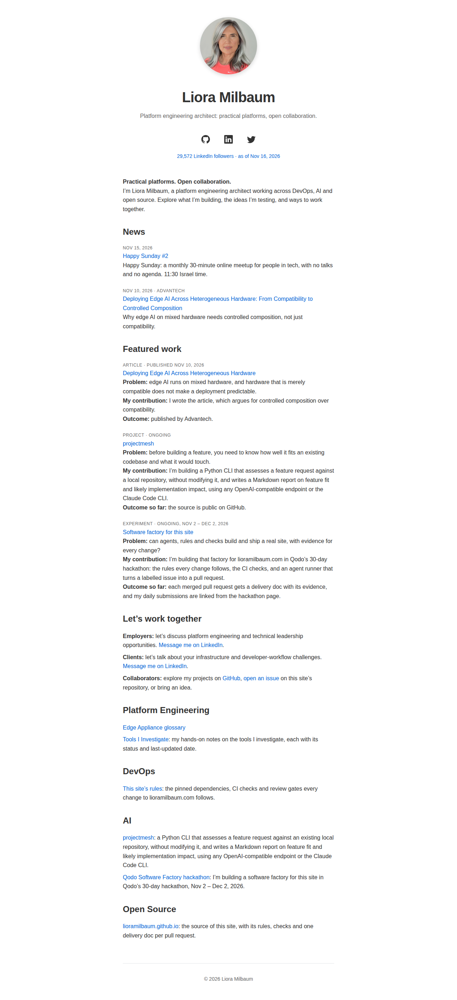

# feat: show the LinkedIn followers count on the homepage

**PR:** [#118](https://github.com/lioramilbaum/lioramilbaum.github.io/pull/118) · **Opened:** 2026-11-16

## Why

_From the PR description (author-written)._

Issue #28: the homepage links to LinkedIn with an icon only, and showing the follower count gives visitors a quick sense of reach. The owner revised the issue on 2026-11-16 to followers only, read from a data file the owner updates, because LinkedIn offers no legitimate live source: its API no longer exposes connection counts, a profile's follower count needs partner API access, scraping breaks LinkedIn's User Agreement, and there is no CORS endpoint.

## How

_From the PR description (author-written)._

- The line is built in Liquid alone. Liquid 4.0.4 has no `liquid` tag and no number-with-delimiter filter, so the template validates the data (a positive integer `followers`, a `YYYY-MM-DD` `as_of`) with assigns and comparisons, and groups the digits with commas in a loop.
- The line sits after the social links' `<nav>`, so `scripts/check-browser.sh`'s `nav[aria-label="Social links"] a` selector is unaffected.
- `scripts/test-site.sh` copies the checkout, writes each data variant to `_data/linkedin.yml`, builds it with `scripts/build-site.sh DIR`, and runs the real `scripts/check-site.sh` on the result. Each case asserts the exit code and the message (AGENTS.md rule 11).

## What

_From the PR description (author-written)._

- `_data/linkedin.yml`: `followers` and `as_of`, updated by the owner.
- `_layouts/home.html`: renders `N LinkedIn followers · as of <date>` under the social links, linked to the LinkedIn profile, and hides it when the data is invalid.
- `scripts/check-site.sh`: asserts the line, its link, its position and its light and dark colours.
- `scripts/test-site.sh`: builds 14 data variants (shown, hidden and grouping cases).
- `.github/workflows/check-site.yml`: runs `scripts/test-site.sh`.
- `AGENTS.md`: documents the line and the test.

## Evidence

- Ran in CI: [run 43816921462](https://github.com/lioramilbaum/lioramilbaum.github.io/actions/runs/43816921462) on 4b197d7 (content 6464f8c61d9c31ed51dd4cc2fb498116be7aabb2). Jobs: build: success.
- Homepage: changed. The head build (H 0e98c047fe5d5cb7aefa00db7c819bccf8308800) differs from the merge-base aefc1d4 build. Screenshot below.
- Local: built the head and the merge-base (aefc1d4) with scripts/build-site.sh, and compared their homepages.

## Screenshot or demo

## What I learned from the Qodo review

Qodo reviewed these contents (by content digest): `2ef9865c491442d09a6d8650aeb707c022005820`, `6464f8c61d9c31ed51dd4cc2fb498116be7aabb2`. Its latest review is content `6464f8c61d9c31ed51dd4cc2fb498116be7aabb2`.

- Quoted follower counts appear as valid (Medium, 🐞 Bug). No longer listed by Qodo. Reviewed in content `2ef9865c491442d09a6d8650aeb707c022005820`, `6464f8c61d9c31ed51dd4cc2fb498116be7aabb2`.
- Site CI gains eight Docker builds and may hit its timeout (Low, 🐞 Bug). No longer listed by Qodo. Reviewed in content `2ef9865c491442d09a6d8650aeb707c022005820`.

Open findings in Qodo's latest review: 0.

_From the PR description (author-written)._

Local review (pre-commit), no stored dismissals:

- a11f44aa "Site CI gains eight Docker builds and may hit its timeout" — false_positive: on the last green Check site run (2026-11-16) Build with Jekyll took 4 s and the build job 4 min 7 s of its 15-minute cap; 14 builds add about 60 s. The owner declined merging builds into one container (it would change build-site.sh's container shape used by CI and the agent runner).
- c8ca06b7 "Invalid owner data fails site CI with a template error" — intentional (owner-approved): rule 11, a homepage missing its line fails; the error names `_data/linkedin.yml` and the expected format.
- 00da73d3 "Impossible as_of date may fail the build instead of hiding the line" — false_positive: the case passes (`bash scripts/test-site.sh` 14/14 PASS), and case_run reports a build failure as FAIL (`scripts/test-site.sh:29-33`); Liquid's date filter returns an unparseable string unchanged.
- Reviewer LOWs fixed before commit: added hidden cases -5, 12abc, true, as_of "", 2026-13-45 and the 1000 → 1,000 grouping case.

PR review (Qodo, head 07dcda5):

- 36d35e51 "Quoted follower counts appear as valid" (Medium) — fixed: quoted digit strings are accepted on purpose (the number shown is the same); the data file's comment now says so, and test-site.sh has a "quoted digits are accepted" case. Commas, decimals and signs are still rejected.
- a11f44aa "Site CI gains eight Docker builds and may hit its timeout" (informational, carried from the local review) — dismissed as false_positive by the agent: on Check site run 43815788729 the new step ran 14 builds in 28 s, and the build job took 4 min 29 s of its 15-minute cap.

## Assistance and third-party material

_From the PR description (author-written)._

- Claude Code (planner, executor, reviewer and git-ops subagents).
- Qodo Codebase Wisdom (code tools; its PR-history tools returned MT-UPSTREAM-DOWN twice).
- Qodo local review of the uncommitted change before commit: two runs. The first failed with a repository-credentials error against the fork and was retried once against upstream with `--repo`, with the owner's approval.
- No third-party code.

## Limitations

_From the PR description (author-written)._

- The count is only as fresh as the owner's last edit of `_data/linkedin.yml`; no live source exists (Why).
- `scripts/test-site.sh` adds about 14 Docker builds to CI, about 4 s each.
- Contrast is asserted by colour in `check-site.sh`, not measured in a browser (owner decision).
- Red CI run (AGENTS.md rule 8): [run 43815621685](https://github.com/lioramilbaum/lioramilbaum.github.io/actions/runs/43815621685) on the deliberately broken revision a6f5289 (the layout without the followers line) failed at Check site with "LinkedIn followers line missing from the homepage".

## Discussion post

This PR has no `## Hackathon` section, so there is no discussion post.
<!-- delivery: content=6464f8c61d9c31ed51dd4cc2fb498116be7aabb2 head=4b197d7878125ed4d737b7a1a082fdc0fcb61e9b homepage=0e98c047fe5d5cb7aefa00db7c819bccf8308800 qodo-open=0 -->
