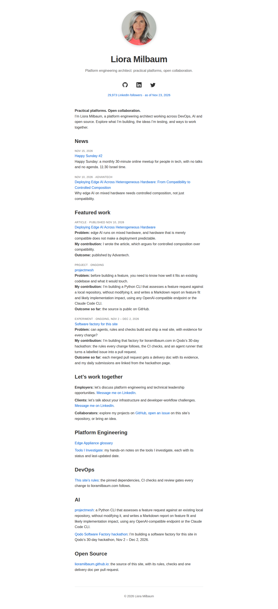

# chore: update the LinkedIn followers count to 29,973

**PR:** [#131](https://github.com/lioramilbaum/lioramilbaum.github.io/pull/131) · **Opened:** 2026-11-23

## Why

_From the PR description (author-written)._

The homepage's LinkedIn followers line was last updated on Nov 16, 2026 (29,572). The owner gave the current count, 29,973, on Nov 23, 2026.

## How

_From the PR description (author-written)._

Ran the `update-linkedin-followers` skill (added in #130, not yet merged) with the owner's count. It validated the count and date, edited the two values in `_data/linkedin.yml`, built the site with `scripts/build-site.sh`, ran `scripts/check-site.sh` and `scripts/test-site.sh`, compared the rendered line with the expected text byte for byte, and built a throwaway copy with `followers: 012` to confirm the check still fails on an invalid value.

## What

_From the PR description (author-written)._

- `_data/linkedin.yml`: `followers: 29973`, `as_of: 2026-11-23`. The homepage line now reads `29,973 LinkedIn followers · as of Nov 23, 2026`.

Local results: build exit 0; `check-site.sh` exit 0 (`Homepage checks passed`); `test-site.sh` exit 0 (`All LinkedIn followers cases passed`); rendered line matches the expected text (1 occurrence); the `followers: 012` copy built (exit 0), failed `check-site.sh` (exit 1, `error: LinkedIn followers line missing from the homepage …`) and hid the line.

## Evidence

- Ran in CI: [run 45111774492](https://github.com/lioramilbaum/lioramilbaum.github.io/actions/runs/45111774492) on 160d088 (content 6cf1d90b531ee003ef0d4aa0f6cbf8e709693f68). Jobs: build: success.
- Homepage: changed. The head build (H 88d2e78c17b8d1aeee9e245efe37bd4cb8a2cf34) differs from the merge-base eaa7b54 build. Screenshot below.
- Local: built the head and the merge-base (eaa7b54) with scripts/build-site.sh, and compared their homepages.

## Screenshot or demo

## What I learned from the Qodo review

Qodo reviewed these contents (by content digest): `6cf1d90b531ee003ef0d4aa0f6cbf8e709693f68`. Its latest review is content `6cf1d90b531ee003ef0d4aa0f6cbf8e709693f68`.

Qodo's latest review lists no findings.

The PR description has no `## Qodo notes` section.

## Assistance and third-party material

_From the PR description (author-written)._

Claude Code (Claude Opus 5.5) ran the skill and opened this PR. The follower count came from the owner. No third-party material.

## Limitations

_From the PR description (author-written)._

The count itself can't be checked in CI: reading it from LinkedIn needs a signed-in account. CI checks its format and the rendered line. This PR adds no code.

## Discussion post

This PR has no `## Hackathon` section, so there is no discussion post.
<!-- delivery: content=6cf1d90b531ee003ef0d4aa0f6cbf8e709693f68 head=160d0882bfac5d01e1928fa6da94f8ab15a92820 homepage=88d2e78c17b8d1aeee9e245efe37bd4cb8a2cf34 qodo-open=0 -->
