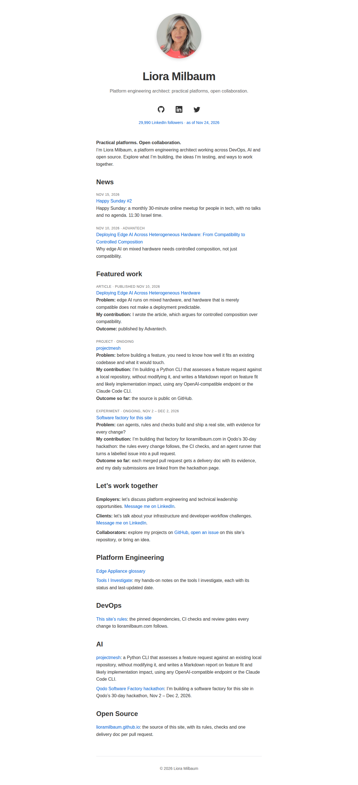

# chore: update the LinkedIn followers count to 29,990

**PR:** [#135](https://github.com/lioramilbaum/lioramilbaum.github.io/pull/135) · **Opened:** 2026-11-24 · **Hackathon:** [Day 13: Teach your factory a new skill](https://github.com/orgs/qodo-hackathon/discussions/15) ([post](https://github.com/qodo-hackathon/software-factory-hackathon/discussions/15#discussioncomment-19859543)): this count update is the second fresh-session run of the `update-linkedin-followers` skill.

## Why

_From the PR description (author-written)._

The homepage's LinkedIn followers line showed 29,975 as of Nov 23, 2026 (#132). The owner gave the current count, 29,990, on Nov 24, 2026.

## How

_From the PR description (author-written)._

Ran the `update-linkedin-followers` skill with the owner's count. It validated the count and date, branched from `upstream/main`, edited `_data/linkedin.yml`, built the site with `scripts/build-site.sh`, ran `scripts/check-site.sh` and `scripts/test-site.sh`, compared the rendered line with the expected text byte for byte, and built a throwaway copy with `followers: 012` to confirm the check still fails on an invalid value.

The run's report, verbatim:

```
input: count=29990, as_of=2026-11-24 (today's date, from `date +%F`)
expected (<WORK>/expected.txt):
29,990 LinkedIn followers · as of Nov 24, 2026
rendered (<WORK>/rendered.txt, 1 line):
<p class="followers"><a href="https://linkedin.com/in/lmilbaum" rel="me noopener">29,990 LinkedIn followers · as of Nov 24, 2026</a></p>
rendered line matches

scripts/build-site.sh: exit=0
 Auto-regeneration: disabled. Use --watch to enable.
bash scripts/check-site.sh _site: exit=0
Homepage checks passed
bash scripts/test-site.sh: exit=0
All LinkedIn followers cases passed

followers: 012 copy: copy exit=0, build exit=0, check-site.sh exit=1
error: LinkedIn followers line missing from the homepage (_data/linkedin.yml needs followers, a positive integer, and as_of, YYYY-MM-DD)
matches of the followers line in the copy's homepage: 0
real file unchanged

git status --short:
 M _data/linkedin.yml
```

## What

_From the PR description (author-written)._

- `_data/linkedin.yml`: `followers: 29990` and `as_of: 2026-11-24`. The homepage line now reads `29,990 LinkedIn followers · as of Nov 24, 2026`.

## Evidence

- Ran in CI: [run 45395616004](https://github.com/lioramilbaum/lioramilbaum.github.io/actions/runs/45395616004) on d7f9888 (content c81e021013c846b0df5a5764080951aa4132ad6d). Jobs: build: success.
- Homepage: changed. The head build (H 23e8c9dd1c25a354dbf649dc95b5f75dadb13804) differs from the merge-base cdea651 build. Screenshot below.
- Local: built the head and the merge-base (cdea651) with scripts/build-site.sh, and compared their homepages.

## Screenshot or demo



## What I learned from the Qodo review

Qodo reviewed these contents (by content digest): `c81e021013c846b0df5a5764080951aa4132ad6d`. Its latest review is content `c81e021013c846b0df5a5764080951aa4132ad6d`.

Qodo's latest review lists no findings.

_From the PR description (author-written)._

None.

## Assistance and third-party material

_From the PR description (author-written)._

Claude Code ran the update-linkedin-followers skill and opened this PR. The follower count came from the owner. No third-party material.

## Limitations

_From the PR description (author-written)._

The count itself can't be checked in CI: reading it from LinkedIn needs a signed-in account. CI checks its format and the rendered line. This PR adds no code.

## Discussion post

For the owner to post in the day's thread. The Delivery doc workflow never posts to the hackathon discussions.

````markdown
## Challenge

[Day 13: Teach your factory a new skill](https://github.com/orgs/qodo-hackathon/discussions/15) ([post](https://github.com/qodo-hackathon/software-factory-hackathon/discussions/15#discussioncomment-19859543)): this count update is the second fresh-session run of the `update-linkedin-followers` skill.

## Project

Project name: lioramilbaum.com
Repository link: https://github.com/lioramilbaum/lioramilbaum.github.io
Relevant pull request or commit: https://github.com/lioramilbaum/lioramilbaum.github.io/pull/135 ([delivery notes](https://github.com/lioramilbaum/lioramilbaum.github.io/blob/main/deliveries/2026-11-24-linkedin-followers-29990.md))

## What I completed

The homepage's LinkedIn followers line showed 29,975 as of Nov 23, 2026 (#132). The owner gave the current count, 29,990, on Nov 24, 2026.

- `_data/linkedin.yml`: `followers: 29990` and `as_of: 2026-11-24`. The homepage line now reads `29,990 LinkedIn followers · as of Nov 24, 2026`.

## Evidence

- Ran in CI: [run 45395616004](https://github.com/lioramilbaum/lioramilbaum.github.io/actions/runs/45395616004) on d7f9888 (content c81e021013c846b0df5a5764080951aa4132ad6d). Jobs: build: success.
- Homepage: changed. The head build (H 23e8c9dd1c25a354dbf649dc95b5f75dadb13804) differs from the merge-base cdea651 build. Screenshot below.
- Local: built the head and the merge-base (cdea651) with scripts/build-site.sh, and compared their homepages.

## What I learned / what is blocked

Qodo reviewed these contents (by content digest): `c81e021013c846b0df5a5764080951aa4132ad6d`. Its latest review is content `c81e021013c846b0df5a5764080951aa4132ad6d`.

Qodo's latest review lists no findings.

The count itself can't be checked in CI: reading it from LinkedIn needs a signed-in account. CI checks its format and the rendered line. This PR adds no code.

## Assistance and third-party material

Claude Code ran the update-linkedin-followers skill and opened this PR. The follower count came from the owner. No third-party material.

## Optional demo


````
<!-- delivery: content=c81e021013c846b0df5a5764080951aa4132ad6d head=d7f988836d4e78171058e7afcfaa0dc95c826dbe homepage=23e8c9dd1c25a354dbf649dc95b5f75dadb13804 qodo-open=0 -->
