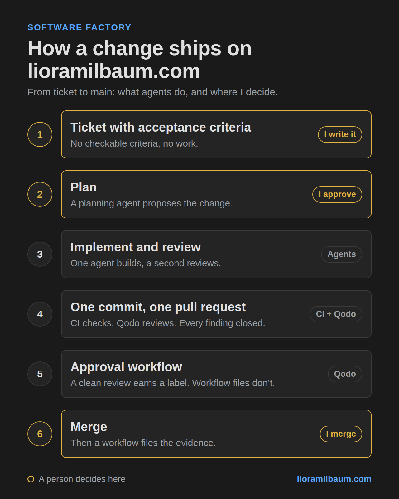

# Building a software factory in Qodo's hackathon

I'm participating in [Qodo](https://www.qodo.ai)'s [Build a Software Factory in 30 Days](https://hackathon.qodo.ai/) hackathon (November 2 – December 2, 2026). My project is this site: the agents, rules and checks that build and ship lioramilbaum.com.

## How a change ships

This site has four pages and eleven written rules. Here is what happens between "I'd like to change something" and the change being live. I decide at three points. Agents, CI and Qodo do the rest.

{: width="1280" height="1600"}

1. **A ticket with acceptance criteria. I write it.** No checkable criteria, no work. Yes, I make myself write them.
2. **A plan. I approve it.** A planning agent reads the ticket and the code and proposes the change. I say yes, or "try again".
3. **Implement and review. Agents do this.** One agent builds and a second one reviews. A new check has to fail once in CI before I believe it.
4. **One commit, one pull request. CI and Qodo check it.** CI runs the site's checks and Qodo reviews the change. Every finding is fixed or dismissed before the merge, and a status check stays red until they are.
5. **The approval workflow. Qodo runs it.** A clean review earns a "Qodo approved" label. Changes to my workflow files never get one, however clean they are. Those come to me.
6. **Merge. I press the button.** A workflow then files the evidence for the change in [deliveries](https://github.com/lioramilbaum/lioramilbaum.github.io/tree/main/deliveries): the CI run, the review history, and a screenshot if the homepage changed.

### This week's catch

A pull request meant to remove stale labels from closed issues ([#138](https://github.com/lioramilbaum/lioramilbaum.github.io/pull/138)). Qodo pointed out that it could put a stale label right back: an agent run that outlives its issue would add one after the cleanup. It was fixed in the same pull request, with five new tests and a slightly bruised ego.

### The lesson I keep relearning

When I read back Qodo's reviews of six pull requests, five had the same bug in different code: a check that passed because it could not read its input. It is now rule 11 in [AGENTS.md](https://github.com/lioramilbaum/lioramilbaum.github.io/blob/main/AGENTS.md): a check that cannot read its input fails. It never passes.

### What doesn't work yet

- The agent that starts from a labelled ticket is not allowed to touch workflow files, so those tickets boomerang back to me.
- My own gate happily passes when the reviewer skips a review. There is [a ticket for that](https://github.com/lioramilbaum/lioramilbaum.github.io/issues/67). Of course there is.
- That status check is only advisory. GitHub would still let me merge on red, and making it a required check is on my list.
- I merge every change myself. That one is on purpose.

## Follow along

- [Daily challenges](https://hackathon.qodo.ai/challenges/)
- [Hackathon discussions](https://github.com/qodo-hackathon/software-factory-hackathon/discussions)

## My submissions

- [Day 1](https://github.com/qodo-hackathon/software-factory-hackathon/discussions/2#discussioncomment-19397091)
- [Day 2](https://github.com/qodo-hackathon/software-factory-hackathon/discussions/4#discussioncomment-19456803)
- [Day 3](https://github.com/qodo-hackathon/software-factory-hackathon/discussions/5#discussioncomment-19469556)
- [Day 4](https://github.com/qodo-hackathon/software-factory-hackathon/discussions/6#discussioncomment-19501367)
- [Day 5](https://github.com/qodo-hackathon/software-factory-hackathon/discussions/7#discussioncomment-19599476)
- [Day 6](https://github.com/qodo-hackathon/software-factory-hackathon/discussions/8#discussioncomment-19607588)
- [Day 7](https://github.com/qodo-hackathon/software-factory-hackathon/discussions/9#discussioncomment-19618604)
- [Day 8](https://github.com/qodo-hackathon/software-factory-hackathon/discussions/10#discussioncomment-19620358)
- [Day 9](https://github.com/qodo-hackathon/software-factory-hackathon/discussions/11#discussioncomment-19646046)
- [Day 10](https://github.com/qodo-hackathon/software-factory-hackathon/discussions/12#discussioncomment-19647866)
- [Day 11](https://github.com/qodo-hackathon/software-factory-hackathon/discussions/13#discussioncomment-19655053)
- [Day 12](https://github.com/qodo-hackathon/software-factory-hackathon/discussions/14#discussioncomment-19820008)
- [Day 13](https://github.com/qodo-hackathon/software-factory-hackathon/discussions/15#discussioncomment-19859543)
- [Day 14](https://github.com/qodo-hackathon/software-factory-hackathon/discussions/16#discussioncomment-19864914)
- [Day 15](https://github.com/qodo-hackathon/software-factory-hackathon/discussions/17#discussioncomment-19879890)
- [Day 16](https://github.com/qodo-hackathon/software-factory-hackathon/discussions/18#discussioncomment-19884457)

Later days are in the [discussions](https://github.com/qodo-hackathon/software-factory-hackathon/discussions).

## The factory's artifacts

- [AGENTS.md](https://github.com/lioramilbaum/lioramilbaum.github.io/blob/main/AGENTS.md): the rules every change follows.
- [deliveries/](https://github.com/lioramilbaum/lioramilbaum.github.io/tree/main/deliveries): one delivery doc per PR.
